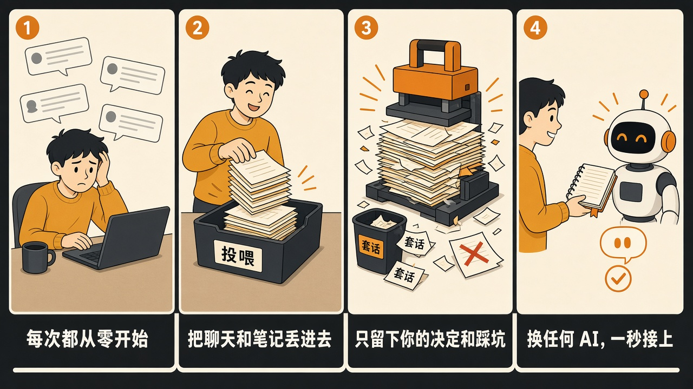

# 个人记忆网络

聊天散落在各个 AI 里，每次都从零开始。把记录丢进一个文件夹，它只留下你的决定和踩过的坑，再交给任何一个 AI。

记忆留在你自己的电脑上。模型只负责计算。



## 三步

1. 安装依赖后运行 `python -m app`（Windows 可双击 `start.bat`）。打开终端里打印的本机地址。
2. 在「投喂与算力配置」填入模型的 API Key，把聊天导出或笔记放进投喂文件夹。
3. 点「跑一轮蒸馏」，再到「一秒挂载」复制一段背景，粘给任何一个 AI。

```bash
git clone https://github.com/qqqqxun/personal-memory-network.git
cd personal-memory-network
python -m pip install -r requirements.txt
python -m app
```

需要 Python 3.10 或更高版本。
