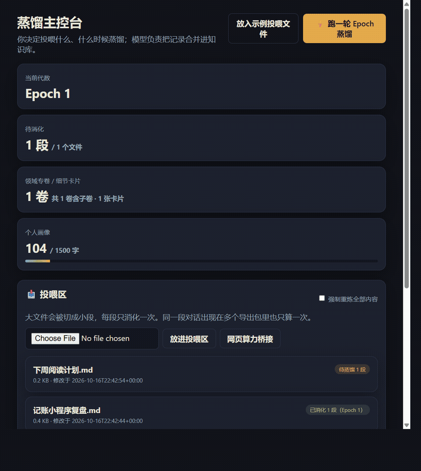

# Personal Memory Network

Chats with ChatGPT, Claude, Gemini, and Grok stay scattered, and every new conversation starts from nothing. This is a local app that distills those chats, plus your own project notes, into a compact personal knowledge base, then gives the relevant part to whichever AI you use next.

The models only compute. The memory stays on your machine, as plain Markdown you can open and edit.



The demo uses a fictional bookkeeping app. It shows the four steps: a note lands in the inbox, distillation keeps the decision and the rejected approach, that becomes a bounded project volume plus a detail card, and a mount pack is copied for any other AI.

- **You choose what it reads.** Drop official exports or your own files into one folder. Nothing else on the disk is scanned.
- **It merges, it does not pile up.** Newer facts replace older ones. Abandoned ideas are kept as "do not recommend again". Generic explanations written by the assistant are dropped.
- **The base stays small as the archive grows.** A short profile, one volume per topic (about 2,000 characters, split into sub-volumes when full), and detail cards that are retrieved only when a question needs them.
- **Mount it anywhere.** Copy one pack into ChatGPT, Claude, Gemini, Grok, or Cursor.

The full guide below is in Chinese.

---

# 个人记忆网络

一个本地运行的个人知识库。你把自己和 ChatGPT、Claude、Gemini、Grok 等 AI 的聊天记录、项目文档放进一个文件夹，它会调用大模型（默认 Gemini）分批“蒸馏”这些材料：只保留属于你本人的信息，合并进一套长度受控的 Markdown 知识库。以后和任何 AI 开始新对话前，把生成的“挂载包”粘过去，它就能直接了解你的背景、进度和踩过的坑，不用从零开始。

外部模型只负责计算，不保存你的记忆；记忆只存在你自己的电脑上。

## 它是怎么工作的

原始记录越来越多，知识库却不会跟着无限变长。系统把知识分成四层：

| 层 | 放什么 | 大小 | 怎么用 |
|---|---|---|---|
| 主基座 | 你是谁、长期目标、协作规则，以及自动生成的领域目录 | 画像约 1500 字 | 每次都挂载 |
| 领域专卷 | 每个长期领域或项目的当前状态、已锁定方案、已证伪方案、待解决问题 | 每卷约 2000 字，卷数不限 | 按任务挑几卷 |
| 细节卡片 | 具体参数、步骤、命令、某个 bug 的解法 | 每张不超过约 400 字，数量不限 | 按任务自动检索 |
| 原始记录 | 你放进投喂区的所有文件 | 不限 | 不挂载，用来重新蒸馏 |

每轮蒸馏时，模型会拿新材料和现有知识库对照：
- 新信息取代旧信息时，用新值替换旧值，被放弃的方案记进“已证伪”，以后不会再被推荐；
- AI 回答里的通用科普、客套话会被丢掉，除非你采纳了它；
- 某卷超过字数上限时，由模型把细节移到卡片里，或者把它拆成几个子卷，不会直接截断。

每一轮之前，整个知识库都会被完整快照下来，随时可以回看或恢复。

## 安装与启动

需要 Python 3.10 或更高版本。目前只在 Windows 上测试过。

```bash
git clone https://github.com/qqqqxun/personal-memory-network.git
cd personal-memory-network
python -m pip install -r requirements.txt
python -m app
```

Windows 下也可以直接双击 `start.bat`。启动后用浏览器打开 <http://127.0.0.1:8765>。

记忆库默认放在 `C:\个人记忆库`。想放到别处（或者在 macOS / Linux 上使用），在「投喂与算力配置」页修改，或启动前设置环境变量 `MEMORY_NET_VAULT_DIR`。

## 第一次使用

1. **配置算力。** 打开「投喂与算力配置」页，填入 Gemini API Key（可以在 [Google AI Studio](https://aistudio.google.com/apikey) 免费申请），保存。模型默认是 `gemini-3.8-flash`；如果这个模型以后下线了，系统会自动查询你的 Key 能用的 flash 模型并改用它。在中国大陆访问时需要代理：留空会自动探测本机常见的代理端口（如 7897、7890），也可以手动填写。
2. **投喂材料。** 把文件放进 `C:\个人记忆库\01_投喂区_Inbox`（可以建子文件夹），或者在主控台直接上传。支持各家 AI 的官方导出包，以及 `.md`、`.txt`、代码等文本文件。
3. **蒸馏。** 点右上角「⚡ 跑一轮 Epoch 蒸馏」。蒸馏在后台分批进行，主控台会显示当前进度。模型繁忙时会自动等待重试；某一批失败时，之前完成的批次会保留，剩下的内容下次接着跑。
4. **查看和修改。** 「知识结晶」页可以直接编辑个人画像、思维铁律、每一卷专卷，也能删除不对的细节卡片。你的修改会作为下一轮蒸馏的基础。
5. **挂载给 AI。** 「一秒挂载」页写上这次要让 AI 做的事，点「生成并复制挂载包」，粘到任何 AI 的对话框里。不勾选专卷时，系统会按任务自动挑最相关的三卷，并检索相关的细节卡片。

每次放进新材料后再跑一轮即可。已经消化过的内容不会重复处理：大文件会被切成约 2 万字一段，每段只消化一次；同一段对话出现在多个导出包里（比如每个月导出一次 ChatGPT），也只算一次。

## 如何导出各家 AI 的聊天记录

| 平台 | 导出方式 | 要放进投喂区的文件 |
|---|---|---|
| ChatGPT | 设置 → 数据控制 → 导出数据，下载邮件里的压缩包 | 整个 zip，或其中的 `conversations.json` |
| Claude | 设置 → 隐私 → 导出数据 | 整个 zip 或 json |
| Gemini | 在 [Google Takeout](https://takeout.google.com) 只选「我的活动 → Gemini Apps」，格式改成 JSON | 整个 zip，或 `MyActivity.json` |
| Grok | 在 [accounts.x.ai/data](https://accounts.x.ai/data) 下载账户数据 | 整个 zip，或 `prod-grok-backend.json` |

压缩包里的账单、登录会话等文件会被自动跳过。Gemini 的导出有时会缺少部分回复，这是 Google 导出本身的限制。

## 浏览器扩展（可选）

`extension/` 里是一个 Chrome / Edge 扩展，可以在 ChatGPT、Claude、Gemini、Grok 的网页里，等回答结束后把对话记到本机。

1. 浏览器打开扩展管理页，打开「开发者模式」。
2. 点「加载已解压的扩展程序」，选择项目里的 `extension` 文件夹。
3. 把「投喂与算力配置」页上显示的本机令牌粘贴进扩展弹窗。

网站改版后扩展可能读不到内容，这时改用官方导出即可。

## 没有 API Key 时

- **本地预脱水。** 没有配置 Key 时点蒸馏，系统只会用本地规则给新材料生成“待蒸馏”卡片，不会改动专卷。这些内容仍算未消化，配好 Key 后再跑一次就会正式写入。
- **网页算力桥接。** 主控台的「网页算力桥接」会把下一批材料打包成一段指令，你粘给任意网页版 AI，再把它返回的 JSON 粘回来，效果和 API 蒸馏一样，只是每次手动处理一批。

## 记忆库目录结构

```text
C:\个人记忆库
├─ 01_投喂区_Inbox              你放材料的地方
├─ 02_已消化归档_Archive         可选：文件全部消化后自动移到这里
├─ 03_知识结晶_Brain
│  ├─ 00_个人主基座_Bootloader.md   个人画像 + 自动生成的领域目录
│  ├─ 01_思维与工程铁律.md          跨领域的规律和偏好
│  ├─ 项目与问题线\                 领域专卷；子卷命名为「父卷__子卷.md」
│  └─ 细节卡片\                     按专卷分文件存放的细节卡片
├─ 04_迭代快照_Epochs            每一轮的完整快照和蒸馏报告
└─ .vault_state.json             哪些内容已经消化过
```

这些都是普通的 Markdown 文件，可以直接用记事本、VS Code 或 Obsidian 打开和修改。

## 隐私与安全

- **记忆只存在本机。** 服务只监听 `127.0.0.1`，网页和扩展访问都需要本机令牌。
- **蒸馏时，投喂区的内容会发给你配置的模型服务商。** 发送前，身份证号、手机号、银行卡号、邮箱、API 密钥和精确住址会在本地被替换成占位符；但健康、财务、人际关系等话题不会被拦截。不想发出去的内容，就不要放进投喂区。
- **免费 API 的数据条款。** Google 对 Gemini API 免费额度的条款允许使用提交的内容改进产品，具体以 Google 最新条款为准。介意的话，可以使用付费额度，或者把算力提供方改成本地 Ollama。
- **API Key 明文保存在 `data/settings.json`。** `data/` 已加入 `.gitignore`，请不要把它提交或分享出去。
- **记忆库没有加密。** 为了方便查看和编辑，知识库是明文 Markdown，请自己保管好这个文件夹。

## 配置项

在 `data/settings.json` 里可以调整的主要内容：

- `budgets`：个人画像、思维铁律、每卷专卷的字数上限，默认 1500 / 1800 / 2000；
- `llm`：算力提供方（`gemini`、`openai_compat`、`ollama`）、模型名、接口地址、代理；
- `vault_dir`：记忆库位置；
- `archive_after_distill`：文件全部消化后是否自动归档。

可用的环境变量：`MEMORY_NET_VAULT_DIR`、`MEMORY_NET_DATA_DIR`、`MEMORY_NET_HOST`、`MEMORY_NET_PORT`、`GEMINI_API_KEY`。

## 已知局限

- 专卷超长后的压缩和拆卷目前只用模拟数据测试过，还没在大量真实数据上验证。
- 本地预脱水的规则比较粗，只适合临时使用，正式蒸馏需要模型。
- 浏览器扩展依赖各网站的页面结构，网站改版后可能失效。
- 代码里还保留着早期版本的问题线数据库、审核队列和出口闸门（`app/db.py`、`app/review.py`、`app/egress.py` 等），目前的界面已经不再使用它们。

## 开发

```bash
python -m pytest -q
```

主要代码：

- `app/vault.py`：记忆库的读写、切段、去重、专卷、细节卡片、快照和挂载包；
- `app/distiller.py`：分批蒸馏、超长压缩与拆卷、模型调用与重试；
- `app/importers/`：各家 AI 导出格式的解析；
- `app/main.py`：本地服务接口；
- `app/static/`：网页界面；
- `extension/`：浏览器扩展。
